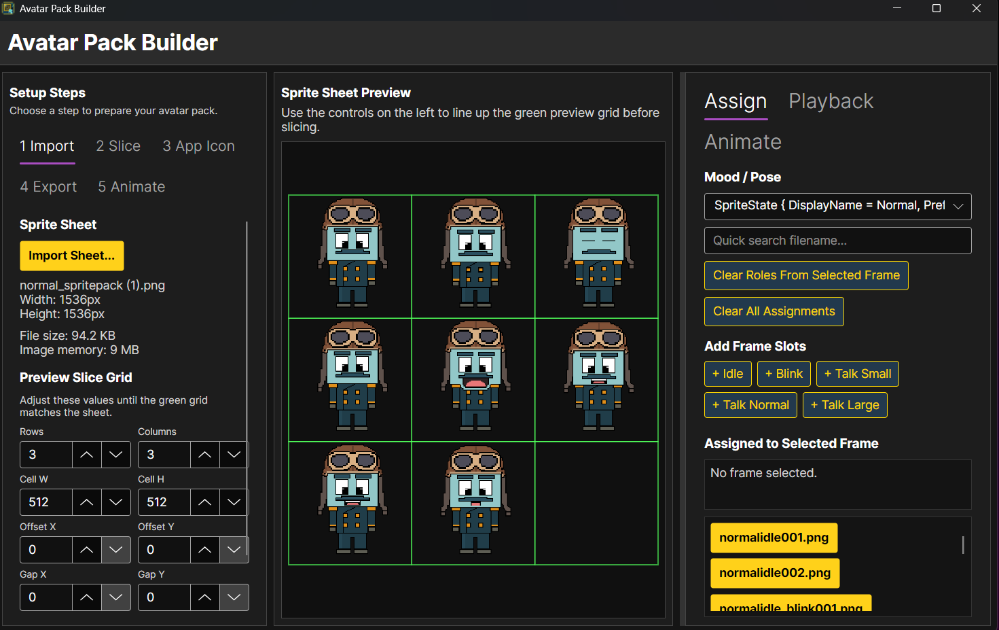
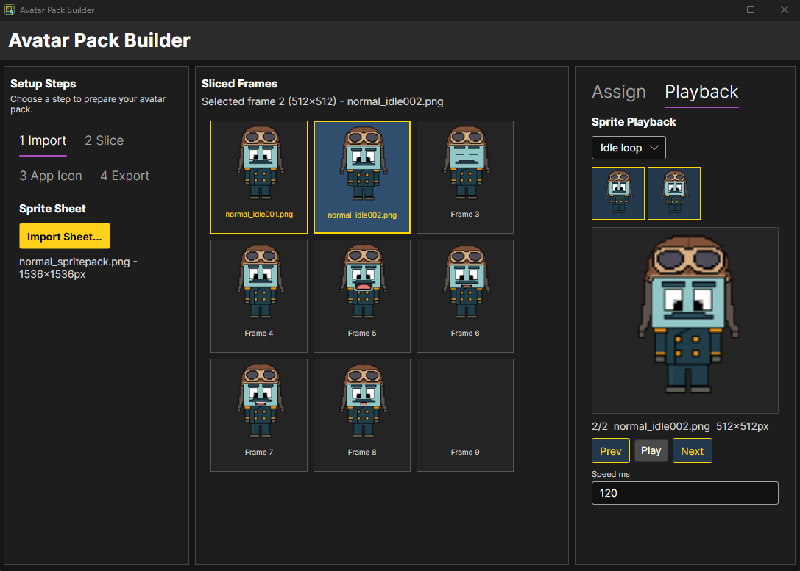

# Avatar Pack Builder (APB)

Create avatar packs from sprite sheets, assign animation roles, preview playback,
and export PNG frames, app icons, animated GIFs, or animation sprite sheets.
Made by **Captain Flasky Studio**.

APB is a standalone Avalonia desktop application. You do not need Stream Avatar
Studio or PixelSpriteTalker to build or run it.

## New in v1.1.0

- **2 Frames** replaces the Slice tab, keeping the same layout and controls.
- Drop individual PNG, JPG/JPEG or BMP images into Frames, including multiple files.
  Build a pack entirely from individual images or combine them with sliced frames.
- Dropped images keep their roles, animation entries and icon selection when the
  sheet grid is reapplied. Sprite sheets still load through **1 Import**.
- Oversized slice grids now explain which cells do not fit instead of silently
  dropping frames. The preview marks overflowing cells red and suggests cell sizes.

See [CHANGELOG.md](CHANGELOG.md) for release details.

## Video demo

[Watch the APB demo on YouTube](https://www.youtube.com/watch?v=itH0s95IqN0&t=73s)
(starts at 1:13). Click the preview below to open the video.

[](https://www.youtube.com/watch?v=itH0s95IqN0&t=73s)

*Import a sprite sheet and line up the grid before slicing your frames.*

## Screenshots



*Assign frames to avatar roles and preview animation playback.*

## Download for Windows

Download `AvatarPackBuilder-v1.1.0-win-x64.zip` from
[GitHub Releases](https://github.com/captainflaskyboy-create/avatar-pack-builder/releases),
extract the entire ZIP, and run `AvatarPackBuilder.exe`.
The Windows x64 release includes .NET; no separate runtime installation is needed.
The application is unsigned. License files accompany the executable.

Verify the download using the release's `SHA256SUMS.txt` and PowerShell:

```powershell
Get-FileHash ./AvatarPackBuilder-v1.1.0-win-x64.zip -Algorithm SHA256
```

## Make an avatar pack

1. Open **1 Import**, choose **Import Sheet...**, and select your sprite sheet.
2. Set rows, columns, cell size, offsets, and spacing so the green grid matches
   your sheet. Select **Use These Slice Settings**, or use **2 Frames** and
   **Apply Slice Grid**.
3. Select a sliced frame. In **Assign**, choose a mood and assign the required
   filename roles. A frame can have multiple roles. Add slots or a custom mood
   when needed.
4. Preview the assigned poses and mouth frames using the playback controls.
5. Optionally use **3 App Icon**, select a frame, choose **Use Selected Frame as Icon**,
   and select icon sizes.
6. In **4 Export**, choose an export folder and pack name, then **Export Pack**.
   Review any missing-frame warning before importing the result into another app.

Pack names use letters, numbers, hyphens, or underscores. Exported role filenames
include `normal_idle001.png` and `normal_talk001.png`, the two minimum required
frames for Stream Avatar Studio. Additional roles include blink, small/large
mouth shapes, and other moods. An optional icon is named `<pack-name>_app_icon.ico`.
Import the resulting pack folder through Stream Avatar Studio's **Import Avatar Pack...**.

Every grid cell must fit completely inside the source image. Partial cells are
marked red in the preview, and applying an oversized grid shows the sheet/grid
dimensions and a suggested maximum cell size. Existing frames and assignments
are kept until valid settings are applied. For example, a 944 x 1464 sheet with
2 columns and 3 rows fits 472 x 488 cells; 474px-wide cells extend past its edge.

Windows slicing regression checks (optionally pass that 944 x 1464 sheet path):

```powershell
dotnet run --project tests/SlicingRegression/SlicingRegression.csproj -- "path/to/sheet.png"
```

Omit the path to test using an in-memory sheet. Checks cover slicing, individual-image imports, mixed-source exports, frame identity,
assignment preservation, and replacement-sheet reset behavior.

## Add individual image frames

Keep using **1 Import** for sprite sheets and the existing grid workflow.
In **2 Frames**, drop PNG, JPG/JPEG or BMP files into the central Frames panel
(including onto an existing tile). Each file becomes one complete selectable
frame. Multiple images append in drop order alongside any sliced sheet frames;
select them and assign sprite-state roles with the existing controls.

You can build a pack entirely from dropped images without loading a sprite
sheet. Dropped frames work with playback, app icons and custom animations too.
Their original dimensions and PNG transparency are retained. Animation exports
center differently sized images in cells sized to the largest frame.

Reapplying the sheet grid keeps dropped images and their assigned roles,
animation entries and icon selection. Importing a new sprite sheet starts
fresh, as before. Invalid files are reported in the Frames workspace without
clearing current work. Imported image data stays in memory for the session;
editing or moving the original files will not alter already imported frames.
Animated image files and folders are not supported as individual frames.

## Export an animation

Use **5 Animate**, click sliced frames in playback order, and use the Animate
panel to preview the sequence. A frame may appear more than once to hold a pose.
Set the name and speed, then export a GIF or PNG sprite sheet. These animation
exports are separate from role-based avatar-pack exports.

## Build from source

Install the [.NET 10 SDK](https://dotnet.microsoft.com/download/dotnet/10.0).
From the repository folder:

```powershell
dotnet restore AvatarPackBuilder.csproj --locked-mode
dotnet build AvatarPackBuilder.csproj -c Debug --no-restore
dotnet run --project AvatarPackBuilder.csproj -c Debug --no-build
```

The first restore needs internet access to NuGet. Package versions are pinned
in the project and `packages.lock.json`. Windows x64 is the verified binary
target; macOS and Linux operation has not been verified for this release.

To create the Windows distribution on Windows with PowerShell 7:

```powershell
./scripts/package-windows.ps1
```

The script restores locked dependencies, publishes a self-contained executable,
and creates the ZIP and checksum under `artifacts/`. Build intermediates, local
paths, debug symbols, and personal configuration are excluded from the release.

## License

APB source and its included app icon are licensed under the [MIT License](LICENSE).
Copyright (c) 2026 Captain Flasky Studio. Third-party dependencies retain their
own licenses; see [THIRD_PARTY_NOTICES.md](THIRD_PARTY_NOTICES.md) and `legal/`.
Images you load and avatar packs you create remain subject to their owners' terms.
Screenshots show example artwork for demonstration. No avatar sprite sheets or
standalone character assets are bundled.

Report bugs and suggest changes through this repository's GitHub Issues.

## Dependency security status

This release preserves the original image-processing code and retains
ImageSharp 3.1.11, which has known moderate and high severity NuGet advisories.
These dependency issues remain unresolved in v1.1.0. Process only images from
sources you trust; the file picker's filters are not a security boundary.

The intended fix is to migrate image processing and exports to SkiaSharp,
following the approach used in Stream Avatar Studio. This migration is planned
and is not included in this release. It must preserve frame naming, transparency,
icon sizes, GIF timing, and avatar-pack compatibility.

ImageSharp advisory references:
- [ICC profile allocation](https://github.com/advisories/GHSA-gwg2-r3hj-4w44)
- [Histogram index validation](https://github.com/advisories/GHSA-j3p4-wp97-rph4)
- [TIFF T4 output buffer](https://github.com/advisories/GHSA-j9gm-c75j-xc9q)
- [TIFF T6 output buffer](https://github.com/advisories/GHSA-jjfr-hcj7-qf5w)
- [BigTIFF decoder loop](https://github.com/advisories/GHSA-wmxv-xphr-5c9g)
